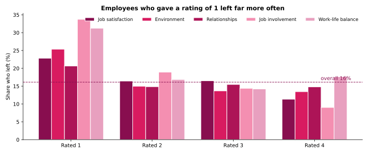
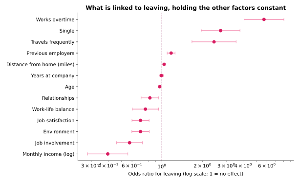
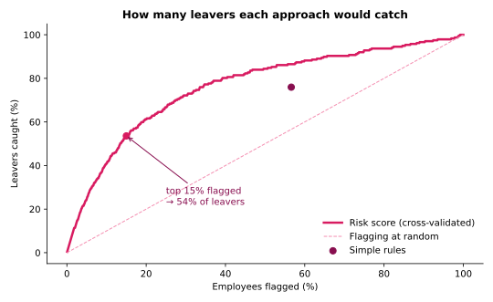

# Employee Engagement and Attrition: Can Survey Scores Flag Who Might Leave?

An analysis of employee survey ratings and attrition for 1,470 employees, ending in an early-warning risk score and an **[interactive dashboard](https://msmontoyaa.github.io/employee-engagement-dashboard/)** that HR or managers could use to spot people who may need support.

**Python · pandas · matplotlib · scipy · statsmodels · scikit-learn · survey (Likert) analysis · chi-square · logistic regression · cross-validation · JavaScript dashboard**

## Questions

1. How do employees rate their job, environment, relationships, involvement and work-life balance?
2. Are low survey scores linked to people leaving?
3. Can a simple early-warning system, built from survey answers and a few HR fields, flag employees at risk before they leave?

## Data

[IBM HR Analytics Employee Attrition dataset](https://github.com/IBM/employee-attrition-aif360): 1,470 employees with five 1-to-4 survey ratings (job satisfaction, environment satisfaction, relationship satisfaction, job involvement, work-life balance), job and pay details, and whether they left. A copy is included in `data/`.

**This is a fictional dataset created by IBM data scientists** for teaching. The findings illustrate the method and do not describe a real company.

## Live dashboard

**[Open the dashboard ↗](https://msmontoyaa.github.io/employee-engagement-dashboard/)**

- Filter by department, overtime and job level
- See how employees rate each area, and the share who left at each rating
- Compare attrition, overtime and engagement across job roles
- A watch list of current employees with the highest risk score, and the reasons they were flagged

The dashboard is a single HTML page with no external libraries. Its data (`dashboard/data.js`) is exported by the notebook.

## Method

1. **Survey distributions.** Share of employees giving each rating on each question, shown as a diverging bar chart.
2. **Ratings and attrition.** Attrition rate at each rating, with chi-square tests, and an engagement index averaging the five ratings.
3. **Groups.** Attrition by department, role and overtime.
4. **Logistic regression.** Each factor's link to leaving while holding the others constant, reported as odds ratios with 95% confidence intervals.
5. **Early warning.** Compared simple rules with a risk score from the regression, scored with 5-fold cross-validation so no employee is scored by a model that saw them.

## Key findings

**1. The lowest rating is the warning sign, not the average.** Average ratings are about 2.7 out of 4 on every question. But 34% of employees who rated job involvement 1 left, against 9% of those who rated it 4.



**2. Overtime is the strongest factor.** 31% of employees on overtime left, against 10% without. After accounting for everything else, overtime multiplies the odds of leaving by 5.7.



**3. Role matters more than department.** Sales representatives left at 40%, laboratory technicians at 24%, and research directors at 3%. Average engagement is nearly identical across roles, so the differences come from factors like seniority and pay.

**4. A combined risk score beats simple rules.**

| Approach | Employees flagged | Leavers caught | Of those flagged, share who left |
|---|---|---|---|
| Simple rules (any rating of 1, or overtime with low work-life balance) | 57% | 76% | 22% |
| Risk score, top 15% | 15% | 54% | **58%** |

The rules flag more than half the company, too many to act on. The risk score (cross-validated AUC 0.81) produces a short list where almost three in five people did leave.



## What an HR team could do with this

- Look at the lowest answers on each question, not averages, and follow up quickly with anyone who rates job involvement or work-life balance 1.
- Review overtime, especially in sales and lab roles.
- Use a short, risk-ranked list for manager check-ins, framed as support.

## Limitations

- **Fictional data.** The numbers describe no real company.
- **A single snapshot.** With no dates, the analysis cannot tell whether low scores came before the decision to leave.
- **Associations, not causes.** Overtime may signal understaffed teams rather than directly causing people to leave.
- **Fairness.** A real risk score should be audited for bias and used only to offer support. Marital status is included here to show its statistical link, but a real system should consider leaving out personal characteristics.
- **Small groups.** HR has 63 employees, so its figures are less certain.

## Repository structure

```
├── engagement_attrition_analysis.ipynb   # full analysis with code, outputs and written interpretation
├── dashboard/
│   ├── index.html                        # interactive dashboard
│   └── data.js                           # employee-level data exported by the notebook
├── data/
│   └── ibm_hr_attrition.csv              # IBM HR Analytics dataset (fictional)
└── images/                               # charts used in this README
```

## How to run

```bash
pip install pandas numpy matplotlib scipy statsmodels scikit-learn jupyter
jupyter notebook engagement_attrition_analysis.ipynb
```

Run all cells from the repository folder. To view the dashboard locally, open `dashboard/index.html` in a browser.

---

**Author:** María Sofía Montoya-Chang · M.S. in Data Analytics · [LinkedIn](https://www.linkedin.com/in/maria-montoya-chang) · [Portfolio](https://msmontoyaa.github.io/)

Data: IBM HR Analytics Employee Attrition & Performance (fictional dataset created by IBM data scientists).
